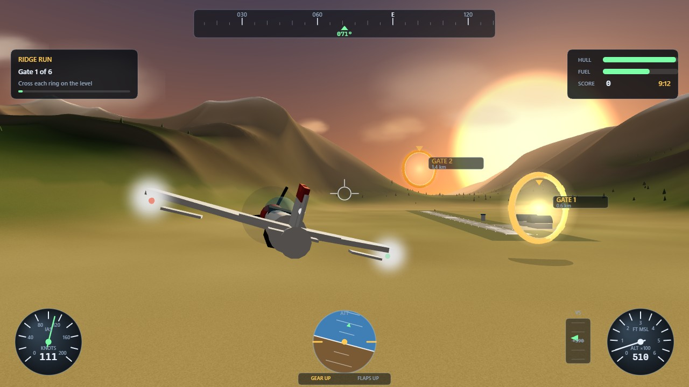
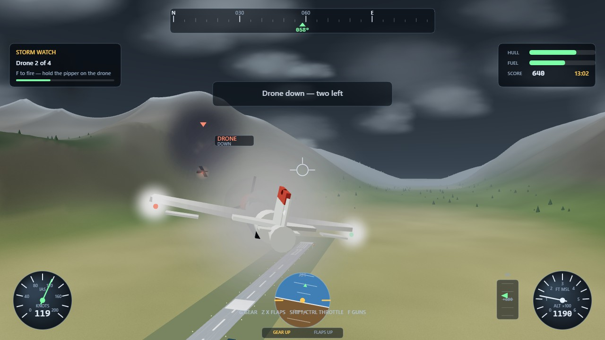
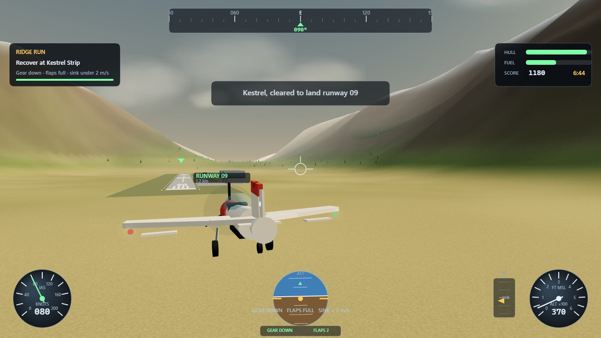
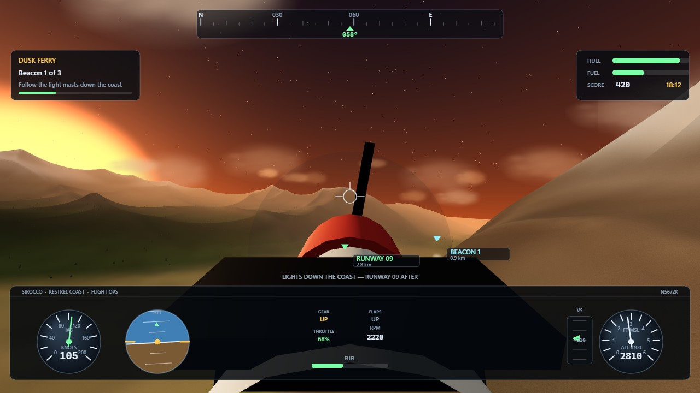

# Sirocco

[](https://make.fun/bounty/best-flight-game-20261126-0057)
[](https://make.fun/bounty/best-flight-game-20261126-0057/leaderboard)
[](https://make.fun/bounty/best-flight-game-20261126-0057/leaderboard)

Five jobs over one coastal island, flown from the cockpit of a light aircraft you can actually
stall, spin, grease onto a runway or put into a hillside.

**Sirocco** is a 3D flight game that runs in a desktop browser with no install, no build step and
no network request: three.js is vendored beside the game, the terrain, aircraft, weather and sound
are generated in code, and every instrument is drawn on a 2D canvas over the WebGL view.






## Play

Open `game/index.html` in Chrome (or any current desktop browser). That is the whole install —
`file://` works, no server needed, nothing is fetched from the network.

Or serve it, which is what the recording and the screenshots used:

```sh
node serve.ts        # http://localhost:8080
```

## Flying

The aeroplane is a 1.2-tonne tourer: 5200 N of thrust, a stall around 34 m/s, and a wing that stops
carrying if you ask too much of it. Thrust fights drag on the flight path, climbing costs airspeed,
banking turns the aircraft, gear and flaps cost speed, and the touchdown is judged on sink rate and
bank angle — under 5.2 m/s and reasonably level is a landing, anything else is a wreck.

| Key | Action |
| --- | --- |
| `W` / `S` or `↑` / `↓` | nose down / nose up |
| `A` / `D` or `←` / `→` | roll left / right |
| `Q` / `E` | rudder |
| `Shift` / `Ctrl` | throttle up / down |
| `G` | gear |
| `Z` / `X` | flaps up / down |
| `B` or `Space` | wheel brakes |
| `F` | guns |
| `C` | chase / cockpit / orbit camera |
| `Esc` | pause |
| `M` | mute |

The wings roll themselves level when the stick is centred and the nose stops climbing at 55°, so a
keyboard is enough to fly it; the rudder and the flaps are there for the pilots who want them.

## The five jobs

- **Ridge Run** — six gates threaded through the eastern pass at dawn, then a landing back at
  Kestrel Strip. Gates pay for a clean, level line.
- **Lifeline** — three supply crates onto valley markers: get low, get slow, get lined up.
- **Storm Watch** — four survey drones over the storm front, guns only, flak coming back at you.
- **Dusk Ferry** — three coast beacons into a night landing, the strip lit by its threshold lights.
- **Open Skies** — no targets and no clock: fly the island and every 500 m of ground you cover pays
  a sightseeing point. The strip is still open whenever you want to land, and the run ends by
  choice or by empty tank, not by a timer.

Each mission starts airborne with the aeroplane trimmed and the throttle part open, so the first
thing you do is fly, not taxi. Score comes from gates, crates, drones, beacons, distance flown with
the island under the wings in Open Skies, a soft touchdown and the time left on the clock; the best
score per job is kept in the browser, and a failed run reports what it cost instead of a score.

## How it is built

```
game/index.html          the two canvases (WebGL view + HUD) and the script order
game/vendor/three.min.js three.js r149, vendored so nothing is fetched at runtime
game/src/config.js       every tuning number, colour and mission definition
game/src/random.js       seeded RNG, value noise, fbm, ridged noise
game/src/terrain.js      the analytic island height field, its mesh, the airfield, the pines
game/src/sky.js          sky dome shader, sun, clouds, stars and the four weather looks
game/src/aircraft.js     the aeroplane: airframe, control surfaces, gear, lights, blob shadow
game/src/flight.js       the flight model: thrust, drag, lift, stall, ground handling, damage
game/src/entities.js     gate rings, drones, drop zones, beacons, flak
game/src/effects.js      pooled sprites: tracers, smoke, fire, explosions, contrails
game/src/hud.js          compass tape, six-pack, target carets, menus, briefings, debrief
game/src/input.js        keyboard and pointer, flattened into one state object
game/src/audio.js        WebAudio engine, wind, guns, warnings — no audio files
game/src/camera.js       chase, cockpit and orbit rigs
game/src/missions.js     objective state, clock, scoring, the end-of-mission report
game/src/shots.js        the staged states the four screenshots are taken from
main.ts                  copies game/ and screenshots/ to /output and writes dossier.json
serve.ts                 a small static server for local play
```

The island is one analytic height function — fractal hills, ridged mountain crests, a meandering
river valley, a coastal falloff and a plateau cut for the airfield — baked into a lookup grid that
the flight model samples for collision, and drawn as a vertex-coloured mesh with a fine grain map.
Weather is a set of uniforms: the same shader dome gives clear dawn, warm haze, a storm front with
lightning, and dusk with stars coming out.

## Screenshots

The four pictures in `screenshots/` are captures of this build running in Chrome at 1280×720, taken
from staged states of the real game (`?shot=1-cover`, `?shot=2-storm`, `?shot=3-landing`,
`?shot=4-cockpit`): the same terrain, the same aeroplane, the same HUD, the same weather system.

## Licence

MIT — see `LICENSE`. three.js is MIT and vendored unmodified.
